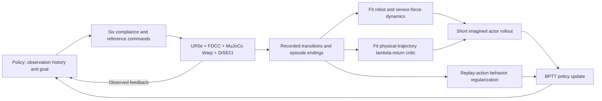

# Paper argument and method review

Review draft for the user and Claude, 2026-11-10, based on the implementation
at `ce346d0` (unchanged by this review),
saved evaluations and the literature notes in [NOVELTY](NOVELTY.md).
This is a research assessment, not an approved new algorithm, run or manuscript
skeleton. [PLAN](PLAN.md) is the sole task list; [METHOD](METHOD.md) maps code;
[Historical evidence](archive/EVIDENCE_20261110.md) links measured results and figures.

Working title: **Learning Compliant Robotic Cutting Across Materials and Shapes
with Differentiable World Models**.

## Revised research direction

Train one shared policy, world model and critic on a declared distribution of
cutting materials and prepared object geometries. The proposed research question
is:

**Can learning robot and sensor-force response support short-horizon policy
optimization for compliant cutting across materials and shapes, and yield
lower contact force at comparable completion to matched-budget SAC?**

This is a hypothesis. Adding objects does not guarantee a useful separation
between methods, lower force or generalization. The contribution would be a
justified cutting-control formulation and demonstrated control benefit, not
a new generic RL algorithm or merely a larger task list.

The current WM + BPTT framework predicts robot and force response and improves
a shared feedback policy. Physical-trajectory value learning and replay-action
regularization form the current working optimization recipe. Execution uses
the policy + FDCC; online planning through the same WM provides a comparator.

The intended evidence is actual task execution across the training distribution,
then separately declared held-out material/geometry conditions. No synthetic
action-perturbation results enter the paper. The earlier ten-episode frozen
elasticity pilot is withdrawn; the new proposal includes task diversity during
training, rather than assuming a fixed-prism model already generalizes.

## Cutting scope and the broader contact problem

The current environment and evidence concern cutting. Cutting is a contact-rich
manipulation task with changing force response and irreversible material change;
the general research question can be learned-model control under contact-force
prediction error. Cutting is the focused test domain for this paper, not
evidence that the same implementation already works in insertion, pushing or
grinding. Adding those tasks would require their environments and validation,
so none is scheduled now.

Non-cutting literature informs the method: MAAC uses learned-model pathwise
policy gradients and an endpoint value; LAMBDA uses world-model uncertainty
for constrained policy learning on Safety-Gym; CAP adjusts model-based safety
costs using uncertainty and real cost feedback. These are precedents, not
extra task requirements or evidence that our contact-specific problem is solved.
Sources: [MAAC](https://arxiv.org/abs/2005.08068),
[LAMBDA](https://arxiv.org/abs/2201.09802),
[CAP](https://arxiv.org/abs/2112.07701).

The intended paper tests a shared cutting controller across materials and
prepared shapes. Generality to other contact tasks remains a future claim.
Do not market the present method as a validated general contact-rich algorithm.

## Historical screening versus training a new policy

B1 uses old interaction data to fit/test force-risk predictors. B2 uses an old
frozen WM to select new MPPI actions and execute physical rollouts. Neither
updates a policy network, and neither proves shared multi-condition learning.
Their bounded role is to decide whether B merits a named training variant.

The main S3 experiment starts fresh WM, policy and critic networks, collecting
new simulation transitions across the declared conditions; SAC also starts
fresh under the matched physical-interaction budget. The WM-only stage and
later online joint learning belong to that new training process. The old
policy62 is a historical reference, not its default starting controller.
B's prediction/planning outcome does not block S0–S2 or substitute for S3.

## Correction: from-scratch capability and continuation are different facts

The source learning chain starts with fresh network weights, a 500-round
WM-only stage and then cumulative policy updates, reaching policy62/WM562 and
8/8 nominal completions. It does not import an expert or externally pretrained
cutting policy. Historical fixes/resumes are documented in RESULTS/METHOD.

The later `real + H8 + BC 0.25` working variant was continued from policy62.
Those specific comparisons measure continuation, but it was too narrow to
describe the entire system as only fine-tuning a supplied controller. Conversely,
the source chain's success is not yet a clean from-scratch validation of the
working variant on a multi-condition distribution. That is part of the proposed
new training comparison.

## Scope and proposed contributions to test

| Proposed contribution | Needed evidence | Current status |
|---|---|---|
| One history-based robot/force model and policy for varied cutting mechanics and prepared geometries | Shared training and physical outcomes per condition; no per-object policy substitution | Compact representation exists; mixed-condition training is not yet connected |
| Model-based policy optimization improves control beyond replay imitation | Physical performance and a relevant actor-objective ablation under the declared task | Fixed-prism BC-only comparison exists; its scope remains that task |
| At comparable completion, contact force is lower than matched-budget SAC | Same training distribution, counted interaction exposure, declared information access and completion criterion | Not established by existing unequal-budget fixed-task checkpoints |
| Transfer to held-out materials/geometries | Disjoint, predeclared training/development/test conditions | Proposed; no result yet |

Multiple materials/objects are the experimental setting, not the contribution
by themselves. The proposed force benefit may be rejected by the results.
Force-limit termination is a task rule, not a guarantee from the learned model.

Unknown material properties are not directly observable before interaction.
A common initial observation can correspond to different force responses.
History enables feedback-based adaptation after informative contact; neither a
ten-frame history nor a deterministic WM proves perfect material identification.
The first version keeps the current network; no uncertainty model, latent
material encoder or new reward is silently introduced.

Different cutting speeds are ordinarily the policy's actions/outcomes.
The exogenous conditions here are material parameters, physically valid object
geometry and placement, with a known task target. No vision/localization claim
is made. Prepared DiSECt cut interfaces remain an inherited restriction.

## What the algorithm actually does

1. **Physical interaction provides training data.** “Physical” here means the
   coupled simulation, not collected real-robot data. DiSECt meshes/material
   settings define the scene; they are not robot demonstrations.
2. **The WM predicts the response needed for control.** It learns 36 next-state
   coordinates: joint position/velocity, three observed wrench samples, and
   within-step peak sensor wrench. A ten-frame history supplies 480 dynamics
   features. FK and task equations derive other state fields and reward.
   Material particles and damage remain hidden from this compact WM.
3. **The critic learns on recorded physical trajectories.** `real` uses
   episode-bounded lambda returns, which still bootstrap. It does not mean
   Monte Carlo ground truth, an exact critic, or a guarantee on imagined states.
4. **The actor is updated through the learned WM.** H8 imagination uses the
   task reward, terminal handling and endpoint critic. BC 0.25 regularizes
   toward recorded clean policy actions, not expert demonstrations.
5. **Deployment uses policy + FDCC.** The trained policy needs neither online
   MPPI nor the WM/critic to choose its action. Simulator differentiability
   is not used for these actor updates.

Code: `control_state.py`, `world_model.py`, and
`OnlineLearner.fit_world_model/imagine/improve_policy` in
[trainer.py](../cutting_world_model/trainer.py). Exact losses and source
differences are in METHOD. No architecture or loss is changed by this review.

## Which parts are inherited, adapted, or still hypotheses?

| Part | Assessment |
|---|---|
| SliceIt action/reward/task, FDCC, DiSECt physics | Inherited platform and task; not a proposed contribution. |
| Learned dynamics, short model rollout, endpoint value and BPTT | Established family of methods; implementation starts from SuperMimic-Reproduced. |
| Compact robot/wrench history with analytic decoding | Task-specific interface; implemented, but no causal evidence that it is superior to all alternative representations. |
| Physical-data critic + short actor horizon + replay BC | A complete working optimization procedure. Individual ingredients have precedents; their contribution must be shown in this task. |
| A: isolate terminal BCE during WM fitting | Completed mechanism analysis, not adopted as the main control method. |
| Uniformly reliable learning, lower force-limit failure risk, multi-material generalization | Not established by the current evidence. |

MAAC already combines a short learned-model rollout, endpoint value and pathwise
policy optimization, and discusses MPC at deployment (§§4.1, 5.4).
[Primary paper](https://arxiv.org/pdf/2005.08068).
Replay-action BC follows the TD3+BC precedent, whose official implementation
documents policy regularization and normalization.
[Official repository](https://github.com/sfujim/TD3_BC).
These precedents belong in the method attribution; their theoretical guarantees
do not automatically apply to our hidden material state and hard task endings.

The novelty question is therefore the cutting-specific formulation and its
demonstrated practical effect. Calling the model a “world model,” replacing the
simulator, shortening H or adding BC does not independently answer that question.

## Historical fixed-task evidence, not the final paper scope

These are selected frozen checkpoints/configurations, not algorithm averages.
Most policy entries have eight deterministic repeats; reference/MPPI entries
are separately recorded executions. All use the same nominal prism task;
the prescribed reference has a different command interface.

| Controller | Recorded outcome | Steps when successful | Material peak when successful |
|---|---|---:|---:|
| policy62, continuation start | 8/8 goal reached | 20 | 30.66 N |
| BC-only continuation, final | 8/8 goal reached | 21 | 29.95 N |
| Working continuation, final | 8/8 goal reached | 19 | 26.10 N |
| Existing unified SAC85k | 8/8 goal reached | 18 | 49.62 N |
| Prescribed reference | Recorded episode reaches goal | 40 | 9.97 N |
| Same-working-WM MPPI + critic | 1/3 planning seeds reaches goal; 2 hit force limit | 33 | 18.68 N |
| Same-working-WM MPPI without critic | 1/3 reaches goal; 2 hit force limit | 37 | 39.73 N |

For MPPI, the force columns describe only its successful seed; failed episodes
remain in RESULTS/EVIDENCE and must not disappear from the comparison.
Goal reached is BENCHMARK's pose-counter criterion, not proof of complete
material separation. Its released-spring fraction is a separate observable.

The working policy's final call takes about 1 ms; the tested MPPI takes about
0.5 s per action. This is online decision cost, not training sample efficiency,
coupled-simulation speed or a novel property of neural policies.

## Research problem → evidence → remaining gap

| Question | What is already available | What can be concluded | Remaining gap relevant to a claim |
|---|---|---|---|
| Is the policy only imitating its replay? | Completed BC-only continuation, same starting policy and nominal schedule. BC-only remains at 20–21 steps; model-objective continuation reaches 17–19. | Adding the full BPTT actor objective changes physical behavior and raises the source task return in this comparison. | One training run per condition. The objective contains both imagined reward and critic; this does not isolate either gradient. |
| Does the complete working method improve the starting controller? | Nominal start/final records and intermediate checkpoints. | Selected final policy completes one step earlier than policy62 and has a lower peak. | The whole continuation and additional interaction differ; intermediate peaks are higher and another same-configuration run collapses temporarily. |
| Does fitting the critic on physical data solve the value problem? | Value-error records, variant runs, imagined-state MPPI estimates. | Selected working checkpoint has low value error on checked physical returns. | No matched H8+BC experiment isolates critic-data source. Imagined-state extrapolation remains; a real-data critic is not automatically reliable there. |
| Is the method better than SAC? | Existing SAC85k, common physical evaluator and task. | Both complete the nominal task; these checkpoints use different force/time profiles. | Unequal histories, training exposure and checkpoint selection; no general ranking or sample-efficiency claim. |
| Is BPTT preferable to same-WM planning? | Exactly paired WM, two fixed MPPI settings, all planning seeds recorded. | The current policy succeeds with lower online cost; the selected planner is fragile. | Planner horizon/search/regularization differ; this is not evidence against MPC generally. |
| Does improved model fitting imply improved control? | Completed A fit and joint-control experiment. | A improved position fit; its pre-stated final-success comparison detected no clear benefit. | Do not turn A's auxiliary stability observations into a new primary result after the fact. |

Action-noise results are excluded from the paper and no new such evaluation is
planned. The existing fixed-task evidence is useful development history; it
does not answer the new shared multi-condition training question.

## Main comparisons and interpretation

- **WM + BPTT vs SAC:** train on the same declared task distribution and count
  every physical interaction, including WM pretraining. Define information
  access and model-selection rules before training. The old SAC85k is not a
  substitute for training on the new distribution.
- **Same-WM MPPI:** use the model paired with the policy being evaluated;
  freeze its search protocol. Record access to control state and online cost.
  Its existing fixed-prism failures cannot establish universal MPC inferiority.
- **Reference trajectory/compliance:** a non-learning system reference with
  per-scene coordinate/goal alignment. Retain the distinction between its
  direct reference branch and the learned six-action interface.
- **Mechanism:** use the already completed BC-only study as development
  evidence; choose any new ablation around the eventual multi-condition method
  claim. A remains completed analysis, not an automatically selected method.

Material force and the filtered sensor wrench are different metrics. Force
comparisons require completed-task evidence and accounting for failed/unfinished
episodes. Success remains the task's pose-counter criterion; material separation
must not be silently inferred from it. Definitions remain in BENCHMARK.

The current fixed-prism peaks, returns and inference times do not yet establish
the proposed multi-condition advantage. The later working-configuration collapse
also prevents a claim of uniformly stable training. Report these facts while
moving to a scientifically declared task distribution, rather than choosing
more artificial disturbances to separate saturated policies.

## Implementation scope and review questions

The existing material scale operator is a useful component. It is not a complete
reset-randomization or multi-object pipeline. The physics batch duplicates one
scene; different topologies need separate homogeneous groups. Their fixed-size
control states can feed one learner, while particle arrays remain per group.

Placement changes must respect DiSECt's prepared cut plane and the coupling's
knife-motion constraint. A cosmetic displacement or changing only observations
does not implement a new physical condition. Cutting-spring stiffness is not
interchangeable with fracture energy or calibrated food toughness.

The ordered S0–S4 plan in PLAN replaces the previous nominal-only review route.
This document does not select numerical randomization ranges or launch jobs.

For Claude/user review, resolve these concrete items:

1. What public base scenes and physically meaningful parameter ranges define
   the train/development/test distributions? Which variations are synthetic?
2. What placement changes preserve the prepared cutting interface, and what
   observable history/goal information is common to learned controllers?
3. Will the final comparison train fresh networks on the full distribution, or
   use a declared common curriculum with all exposure counted?
4. What predeclared completion criterion and force statistic test “comparable
   completion with lower force,” without conditioning away failures?

These decisions determine the executable experiment. They are not reasons to
resume action-noise evaluation or restart an unrelated numerical-debug campaign.
