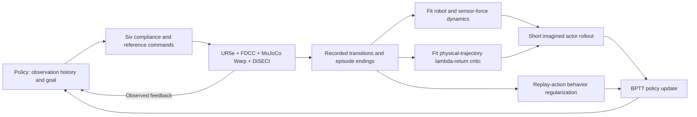

# Paper argument and method review

Review draft for the user and Claude, 2026-11-10, based on code `2354af7`,
saved evaluations and the literature notes in [NOVELTY](NOVELTY.md).
This is a research assessment, not an approved new algorithm, run or manuscript
skeleton. [PLAN](PLAN.md) is the sole task list; [METHOD](METHOD.md) maps code;
[EVIDENCE](EVIDENCE.md) links measured results and figures.

Working title: **World-Model Policy Optimization for Force-Limited Robotic Cutting**.
“Force-limited” describes the task's stopping rule, not a safety guarantee.

## Recommendation

Keep the current method and trained nominal prism task. The strongest supported
question is:

**Can differentiable model-based policy updates improve an already functional
compliant-cutting controller, while leaving deployment to a fast feedback policy?**

The algorithm can ultimately be studied from scratch, but the current working
method's evidence is continuation from a successful policy62/WM562 checkpoint.
Policy62 already completes the task. Do not describe the continuation as learning
to cut from failure, or its data cost as a complete from-scratch training budget.

A proposed contribution statement, still requiring review, is:

> A robot-and-force history model supports short-horizon policy refinement for
> compliant cutting, with value learning on recorded physical trajectories and
> behavior regularization toward replay actions. The resulting controller is
> evaluated in the original physical task against its starting controller,
> imitation-only continuation, the existing SAC and same-model online planning.

This identifies a task-specific method and the evidence needed for it. It does
not establish a new generic RL algorithm or a demonstrated safety mechanism.
The present results constitute a working method and a preliminary comparative
study; their current breadth does not by itself establish a strong final
publication contribution. Adding disturbance or material cases would not
resolve an unclear method claim.

## Why this is a control problem worth formulating

Compliance and reference commands affect both cutting progress and the sensed
reaction. Recent interaction history carries information about the response of
the controller and deforming material. The proposed use of a WM is to learn
those action consequences and use their gradients during policy improvement.
That is the motivation; lower physical-data cost and safer control are benefits
to demonstrate, not consequences of merely having a differentiable network.

SAC supplies an existing learned controller without an explicit transition
model. Our BPTT procedure uses a learned transition model during actor training.
The same-WM MPPI searches action sequences at deployment. This comparison asks
how the model is used, not whether the plant is differentiable. Cheap policy
inference is also available to SAC, so it is only a practical distinction from
online planning, not a unique contribution over all alternatives.

## What the algorithm actually does

1. **Physical interaction provides training data.** “Physical” here means the
   coupled simulation, not collected real-robot data. DiSECt meshes/material
   settings define the scene; they are not robot demonstrations.
2. **The WM predicts the response needed for control.** It learns 36 next-state
   coordinates: joint position/velocity, three observed wrench samples, and
   within-step peak sensor wrench. A ten-frame history supplies 480 dynamics
   features. FK and task equations derive other state fields and reward.
   Material particles and damage remain hidden from this compact WM.
3. **The critic learns on recorded physical trajectories.** `real` uses
   episode-bounded lambda returns, which still bootstrap. It does not mean
   Monte Carlo ground truth, an exact critic, or a guarantee on imagined states.
4. **The actor is updated through the learned WM.** H8 imagination uses the
   task reward, terminal handling and endpoint critic. BC 0.25 regularizes
   toward recorded clean policy actions, not expert demonstrations.
5. **Deployment uses policy + FDCC.** The trained policy needs neither online
   MPPI nor the WM/critic to choose its action. Simulator differentiability
   is not used for these actor updates.

Code: `control_state.py`, `world_model.py`, and
`OnlineLearner.fit_world_model/imagine/improve_policy` in
[trainer.py](../cutting_world_model/trainer.py). Exact losses and source
differences are in METHOD. No architecture or loss is changed by this review.

## Which parts are inherited, adapted, or still hypotheses?

| Part | Assessment |
|---|---|
| SliceIt action/reward/task, FDCC, DiSECt physics | Inherited platform and task; not a proposed contribution. |
| Learned dynamics, short model rollout, endpoint value and BPTT | Established family of methods; implementation starts from SuperMimic-Reproduced. |
| Compact robot/wrench history with analytic decoding | Task-specific interface; implemented, but no causal evidence that it is superior to all alternative representations. |
| Physical-data critic + short actor horizon + replay BC | A complete working optimization procedure. Individual ingredients have precedents; their contribution must be shown in this task. |
| A: isolate terminal BCE during WM fitting | Completed mechanism analysis, not adopted as the main control method. |
| Uniformly reliable learning, lower force-limit failure risk, multi-material generalization | Not established by the current evidence. |

MAAC already combines a short learned-model rollout, endpoint value and pathwise
policy optimization, and discusses MPC at deployment (§§4.1, 5.4).
[Primary paper](https://arxiv.org/pdf/2005.08068).
Replay-action BC follows the TD3+BC precedent, whose official implementation
documents policy regularization and normalization.
[Official repository](https://github.com/sfujim/TD3_BC).
These precedents belong in the method attribution; their theoretical guarantees
do not automatically apply to our hidden material state and hard task endings.

The novelty question is therefore the cutting-specific formulation and its
demonstrated practical effect. Calling the model a “world model,” replacing the
simulator, shortening H or adding BC does not independently answer that question.

## What the nominal task already shows

These are selected frozen checkpoints/configurations, not algorithm averages.
Most policy entries have eight deterministic repeats; reference/MPPI entries
are separately recorded executions. All use the same nominal prism task;
the prescribed reference has a different command interface.

| Controller | Recorded outcome | Steps when successful | Material peak when successful |
|---|---|---:|---:|
| policy62, continuation start | 8/8 goal reached | 20 | 30.66 N |
| BC-only continuation, final | 8/8 goal reached | 21 | 29.95 N |
| Working continuation, final | 8/8 goal reached | 19 | 26.10 N |
| Existing unified SAC85k | 8/8 goal reached | 18 | 49.62 N |
| Prescribed reference | Recorded episode reaches goal | 40 | 9.97 N |
| Same-working-WM MPPI + critic | 1/3 planning seeds reaches goal; 2 hit force limit | 33 | 18.68 N |
| Same-working-WM MPPI without critic | 1/3 reaches goal; 2 hit force limit | 37 | 39.73 N |

For MPPI, the force columns describe only its successful seed; failed episodes
remain in RESULTS/EVIDENCE and must not disappear from the comparison.
Goal reached is BENCHMARK's pose-counter criterion, not proof of complete
material separation. Its released-spring fraction is a separate observable.

The working policy's final call takes about 1 ms; the tested MPPI takes about
0.5 s per action. This is online decision cost, not training sample efficiency,
coupled-simulation speed or a novel property of neural policies.

## Research problem → evidence → remaining gap

| Question | What is already available | What can be concluded | Remaining gap relevant to a claim |
|---|---|---|---|
| Is the policy only imitating its replay? | Completed BC-only continuation, same starting policy and nominal schedule. BC-only remains at 20–21 steps; model-objective continuation reaches 17–19. | Adding the full BPTT actor objective changes physical behavior and raises the source task return in this comparison. | One training run per condition. The objective contains both imagined reward and critic; this does not isolate either gradient. |
| Does the complete working method improve the starting controller? | Nominal start/final records and intermediate checkpoints. | Selected final policy completes one step earlier than policy62 and has a lower peak. | The whole continuation and additional interaction differ; intermediate peaks are higher and another same-configuration run collapses temporarily. |
| Does fitting the critic on physical data solve the value problem? | Value-error records, variant runs, imagined-state MPPI estimates. | Selected working checkpoint has low value error on checked physical returns. | No matched H8+BC experiment isolates critic-data source. Imagined-state extrapolation remains; a real-data critic is not automatically reliable there. |
| Is the method better than SAC? | Existing SAC85k, common physical evaluator and task. | Both complete the nominal task; these checkpoints use different force/time profiles. | Unequal histories, training exposure and checkpoint selection; no general ranking or sample-efficiency claim. |
| Is BPTT preferable to same-WM planning? | Exactly paired WM, two fixed MPPI settings, all planning seeds recorded. | The current policy succeeds with lower online cost; the selected planner is fragile. | Planner horizon/search/regularization differ; this is not evidence against MPC generally. |
| Does improved model fitting imply improved control? | Completed A fit and joint-control experiment. | A improved position fit; its pre-stated final-success comparison detected no clear benefit. | Do not turn A's auxiliary stability observations into a new primary result after the fact. |

The action-noise results remain supplementary. Their local disturbance
distribution is not hardware-calibrated and is not a required part of the task.
They do not repair the attribution gaps in this table. Material/domain
randomization is not required to ask any of the questions above.

## What the paper can center on, and what it cannot

**Recommended center:** the connected method for model-based refinement of
compliant-cutting control, its physical execution, and the role of learned
imagination beyond replay imitation. The existing BC-only comparison is the
most directly relevant mechanism evidence. Use nominal executions first.

The current evidence does not support centering the paper on “safe/reliable
learning,” because a same-configuration continuation temporarily collapses.
It also does not support “superior sample efficiency,” “first world-model cutting
algorithm,” “new differentiable cutting simulator,” or “generalizes across
materials.” Those are different claims requiring different evidence.

A known prescribed trajectory already completes the nominal task. Therefore
“the robot can cut” is feasibility, not by itself a learning contribution.
Nor is beating a deliberately slower reference in elapsed time sufficient.
The selected final working policy is lighter than SAC85k but slightly slower;
the reference is lighter still. None of these isolated metrics establishes
overall superiority.

An applied robotics-method paper may present an existing algorithmic family
adapted to a meaningful control problem, but the task-specific gain and scope
must be substantive and reproducible. A single fixed simulated prism plus one
selected continuation is currently preliminary evidence. More plots or invented
disturbances cannot substitute for a justified claim.

## Proposal for the next decision, for Claude to review

1. **Keep one working algorithm.** Keep `real + H8 + BC 0.25` for this review;
   no A promotion, architecture search or reward change.
2. **Use completed evidence first.** BC-only, starting policy, all working
   checkpoints, existing SAC, same-WM MPPI and reference already answer distinct
   parts of the table. Do not repeat them merely because their results are mixed.
3. **Choose the scope of the contribution.** A task-level policy-refinement
   study is the narrower supported route. If instead the claim is that the
   physical-data critic makes BPTT effective/reliable, that needs a matched
   component comparison; current variants change too many things together.
4. **Only for that latter claim, propose one missing comparison:** recorded
   versus imagined critic targets with the same H8, BC, starting policy/WM,
   critic initialization, update schedule and evaluation protocol. It is a
   candidate experiment, not a runnable/approved protocol yet. Equal pre-fit
   treatment and implementation feasibility must be specified; comparing
   `source H32/no BC` directly with `real H8/BC` does not isolate the cause.
   One development pair would not establish seed-level reliability. No run is
   launched, budget committed or improvement threshold invented in this review.

This is a decision between paper scopes, not a plan to accumulate every possible
ablation. If neither the existing effect nor one clearly motivated mechanism
offers a convincing contribution, say so before buying more GPU time. Material
variation, perturbation sweeps and repeated bug-fix demonstrations would not
answer that scientific problem.

## Questions for Claude's review

- Does the recommended scope honestly describe warm-start refinement rather
  than learning cutting from scratch? Is that useful enough for the intended
  paper, and what exactly is the task-specific contribution?
- Does the code/source mapping above omit a relevant input, gradient path or
  training change? Separate corrections from proposed new algorithms.
- Do the BC-only and full-objective records support the limited behavioral
  conclusion? Keep the later collapse and failed planner seeds visible.
- Is the physical-critic mechanism essential to the proposed claim? If yes,
  identify one missing counterfactual and its expected discriminating outcome;
  if not, do not add that experiment to the queue.

The review should end in one selected claim and its necessary evidence, or an
explicit statement that the present method is not yet a convincing methods
contribution. PLAN records the next action; no experiment follows automatically
from this document.
