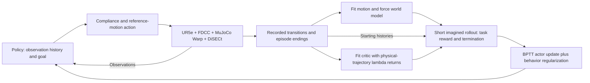

# Paper direction and algorithm

Working title: **World-Model Policy Optimization for Force-Limited Robotic Cutting**.

This document holds the research argument and algorithm structure. [PLAN](PLAN.md)
holds the current work and run approvals; [METHOD](METHOD.md) maps implementation
and sources; [BENCHMARK](BENCHMARK.md) defines the task and metrics;
[RESULTS](RESULTS.md) holds measurements; [NOVELTY](NOVELTY.md) holds literature
evidence. Updated 2026-11-10 against code and results at `d6f3865`.
This is the research-direction document, not a manuscript skeleton.

## One research question

**How can a learned model of robot–material interaction support policy
optimization whose predicted gains carry over to executed, force-limited
compliant cutting?**

The policy controls compliance and reference motion. Its actions affect both
progress and contact force. The model must therefore support decisions about
motion, force and when an episode ends, rather than just fit an average next
state. A wrong end state can also make the actor query its critic after the
physical task would have stopped.

The working algorithm learns a motion/force model from physical interaction,
fits a critic on physical-trajectory lambda returns, and improves the policy
through short model rollouts with recorded-action behavior regularization.
The current implementation is `real` critic + H8 + BC 0.25. This is a complete
algorithmic procedure; its inherited components and the evidence for the
cutting-specific arrangement must be identified separately.

Candidate A changes only the terminal-supervision gradient during WM fitting.
Its joint control comparison is complete: the pre-stated final-success
difference was inconclusive, so A remains a mechanism variant rather than part
of the selected main algorithm. The paper must not assume that better
prediction necessarily produces better control.

The research unit is a single cut. Changes of material and geometry test transfer
of the method after the fixed task works. Multiple cuts, topology planning and
camera-based manipulation are outside this paper's current scope.

## Algorithm and data flow

The physics executes actions and supplies new training data. Gradients for the
actor pass through the learned model. At deployment the policy and compliance
controller act on observations; the model and critic support training.

### 1. Learn the robot and force response

The policy reads ten observation frames and the target pose, then outputs the
existing six-dimensional SliceIt action. The action mapper changes compliance
parameters and reference motion. Data come from this policy interacting with
the coupled robot/material simulation, including successful and failed episodes.
DiSECt assets specify the physical scene; they are not a robot-demonstration set.

The current model predicts residual updates of joint position, joint velocity,
sensor-wrench history and within-control-step peak wrench. Forward kinematics
and the existing task equations derive tip pose, observations, reward and task
predicates. History supplies information about the recent controller and contact
response. Material particles and damage are advanced by DiSECt; they are not
outputs of this compact model.

Code: [control_state.py](../cutting_world_model/control_state.py),
[world_model.py](../cutting_world_model/world_model.py),
[policy.py](../cutting_world_model/policy.py).

### 2. Fit the model and test terminal-supervision coupling

The working baseline fits both state error and terminal BCE, with the terminal
head reading the predicted state's features. Its BCE gradient can update the
dynamics network. Candidate A, reported as a separate analysis, instead uses

$$
L_{WM}=L_{state}(\hat s,s')+
\operatorname{BCE}(g_\psi(\operatorname{stopgrad}(\hat s)),d).
$$

State supervision trains the dynamics; terminal supervision trains the terminal
head. During actor training the head reads the predicted state with its gradient
intact. Hard task predicates absorb ended imagined trajectories, while the
learned terminal probability supplies the existing survival weighting. The hard
event boundary itself has no continuous derivative.

This split is implemented by `fit_predict()` versus `predict()`. Fixed-data
position prediction improved. In the completed joint comparison, A minus baseline
final perturbed success was -1.6 percentage points [-5.9, 3.1]. A had no observed
mid-training collapse in that run; one seed per arm does not establish general
training stability. Those evaluations used raw-output perturbations, distinct
from the later cross-controller executed-action evaluation.
This structure does not enforce a force–motion conservation law, and its history
representation still has to predict effects of hidden material/controller state.

### 3. Improve the policy through short imagined trajectories

The actor maximizes the implemented survival-weighted return

$$
J=\mathbb E\left[\sum_{k=0}^{H-1}\gamma^k c_k\hat r_{k+1}
+\gamma^Hc_H V(\hat s_H)\right],\qquad
c_k=\prod_{j=1}^{k}(1-\hat d_j).
$$

The working baseline uses H = 8, recorded-action behavior regularization
(`actor_bc_alpha=0.25`) and `critic_target=real`. The critic fits lambda returns
from recorded physical states, rewards and episode endings; those returns still
bootstrap from a critic estimate. The behavior target is the recorded clean
policy action, not an expert demonstration. WM and critic parameters are frozen
during the actor step, while gradients through their inputs remain connected.

Code: [trainer.py](../cutting_world_model/trainer.py),
[objective.py](../third_party/supermimic/objective.py). Exact regularization,
normalization and source differences are in [METHOD](METHOD.md).

### What is inherited, and what is being tested

| Part | Role in the paper | Current evidence |
|---|---|---|
| SliceIt task, FDCC and DiSECt; unified MuJoCo Warp execution | Shared experimental platform | Running task and frozen policies |
| SuperMimic-style learned model and BPTT actor | Starting learning framework | Connected training and source configuration |
| Compact motion/force history with analytic decoding | Cutting-specific model interface | Implemented; prediction results |
| Physical-trajectory critic, short horizon and behavior regularization | Current working learning baseline | Single-seed continuation and BC-only comparison |
| A: isolate terminal supervision during WM fitting | Completed mechanism variant | Improved fixed-data position prediction; no clear final-success benefit under the pre-stated control criterion |

WM + BPTT, stop-gradient, lambda returns and behavior regularization have existing
precedents. The proposed contribution concerns how their cutting-specific
arrangement supports executed control; novelty and scope require evidence, not
merely a list of components. Current results establish a functioning learning
procedure, checkpoint-level improvements and comparisons. They do not yet
establish general superiority, sample efficiency or reduced force-limit risk.

## Evidence that motivates the method

Three completed observations explain the mechanism study:

1. **The learned objective changes behavior.** From policy62, BC-only takes
   20–21 steps; the working actor objective gives 17–19 steps and often higher
   material force, in one seed. This establishes an effect of the objective,
   not a sample-efficiency result.
2. **Event supervision can damage state prediction.** With the same fixed data
   and 100 fitting rounds, A changes held-out H8 tip error from 7.88 to 0.28 mm.
   Force-limit/workspace prediction remains poor on underrepresented endings.
3. **Force and event errors have different consequences.** On five checked
   successful trajectories, predicted peak sensor force has 1.58 N mean absolute
   error and captures the faster policies' higher force. Of 40 physically
   successful branches, only 14 are predicted successful. Missed endings lead
   to critic evaluation beyond the physical episode. The branch score was a
   proxy, so its discrepancy does not establish an error in the actor gradient.

These observations motivated the now-completed A comparison. They do not
support attributing the checked policies' higher force to systematic force
underprediction. Separate onset-force failures remain relevant when interpreting
failure episodes. Full splits and numbers are in RESULTS (2026-11-08/09).

The completed 256-case executed-action comparison gives the current working
policy 83.2% success versus 74.6% for policy62 and 89.1% for SAC85k. The working
policy has a lower mean material peak than SAC85k (29.7 vs 45.4 N), but the
force-limit failure difference is inconclusive. Its whole continuation procedure
improved over its starting checkpoint; that comparison alone does not isolate
the benefit of model gradients. Peak, mean force and impulse are distinct
quantities, and force values do not replace task-completion outcomes.

## Main experiments and what each would establish

| Question | Comparison | Evidence to report |
|---|---|---|
| Does the mechanism improve control? | Working baseline vs baseline + A, identical continuation setup | Physical task outcomes and learning curves; existing prediction evidence explains the intervention |
| Does the learned gradient matter? | Full actor objective vs BC-only; source/critic variants for attribution | Physical behavior and return, with each changed component identified |
| How does it compare with alternatives? | Selected checkpoints, SAC85k, same-WM MPC and fixed control | Shared physical task; disclose unequal input histories/training budgets and separate reference action branch; report outcomes, force and compute |
| Does it extend beyond one configuration? | Material variation, then held-out materials/shapes | Per-condition task and force outcomes; single-cut structure retained |

The A experiment and the selected-controller fixed-prism evaluations are
complete. The next deliverable is their evidence package and supported argument,
not another A experiment or mandatory SAC retraining. Material transfer is a
separate, bounded next-stage question. Multi-seed runs follow a fixed method and
comparison protocol.

The source-to-working-baseline comparison changes critic targets, horizon and
behavior regularization together. Attributing a benefit to one of them requires
a matched ablation; that package comparison alone does not isolate the cause.

The existing unified-environment SAC85k is the model-free checkpoint comparison.
It retains source SAC training settings but is adapted to our public-prism
MuJoCo environment; it is not a full reproduction of the SliceIt paper.
Its selection before the later collapse, single training environment, input and
data budget are disclosed. It can be used now without retraining; general
algorithm rankings and sample-efficiency claims require a different protocol.

A receding-horizon planner using the same WM
tests planning versus a learned BPTT policy with a common dynamics model. A
classical fixed compliance controller supplies a model-independent reference.
DiSECt direct trajectory optimization is a separate physical-model method and
remains parked. Prescribed trajectories bypass the policy action mapper, so
their results are labeled separately from action-matched controllers.

Use BENCHMARK's separate outcome and force metrics. The primary question is
executed task performance and failure risk; prediction loss supports the
explanation. The unchanged reward accepts some speed/force trade-offs. A
terminal-gradient intervention is not automatically expected to make cuts both
faster and lighter. Reduced force is a claim only if it is measured at comparable
completion performance.

The present system comparison keeps each controller's information interface and
reports its differences; it does not isolate the learning algorithm. For a
future controlled algorithm or sample-efficiency comparison, define information
access, physical-transition budgets including pretraining/warm starts,
checkpoint selection and update schedules, and report training wall time and
online control cost separately. Current policy62/WM562
continuations measure improvement from a common start. From-scratch sample
efficiency requires a separate matched experiment. Frozen repeats of a
deterministic task are not independent training seeds.

## Writing structure and stopping rule

Write the paper as **problem → model and supervision → policy optimization →
physical control evidence → generalization**. Introduce the force-limited task
and model-based alternatives, present the connected algorithm above, then use
the mechanism experiment to explain the main task results. Put bug fixes,
API checks and integration details in implementation notes. Model-fitting plots
support the argument; they do not replace cutting results.

The A decision is closed under its pre-stated primary criterion; its auxiliary
observations remain analysis. Reuse completed task comparisons and mechanism
evidence before proposing additional experiments. SAC retraining is conditional
on a new claim or task requirement, not a gate on current interpretation.
No new manuscript skeleton, training or diagnostic batch follows automatically
from updating this research-direction document.

Real-robot force claims require the separately planned physical experiments in
[REAL2SIM](REAL2SIM.md). Literature positioning follows NOVELTY; the thesis here
sets the experiment's question rather than asserting priority over prior work.
